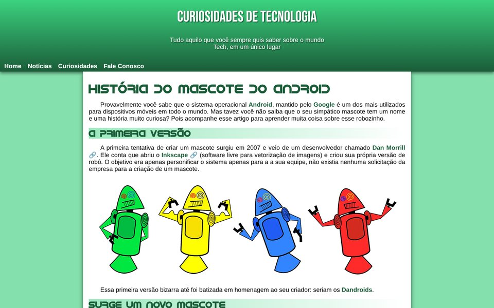
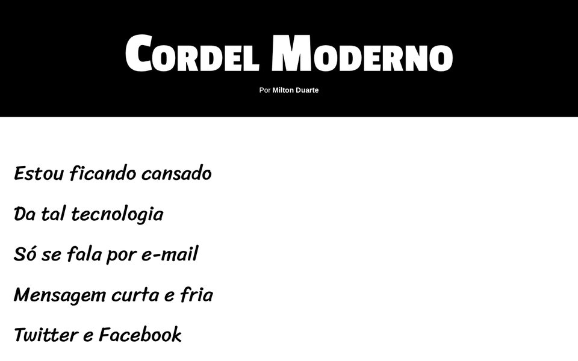
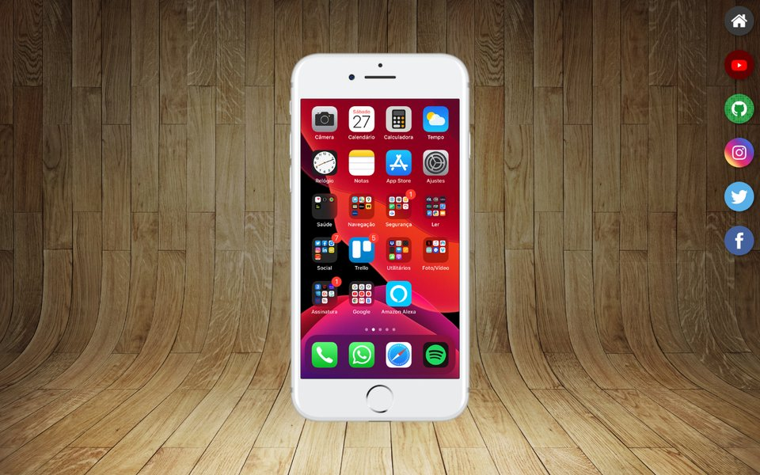
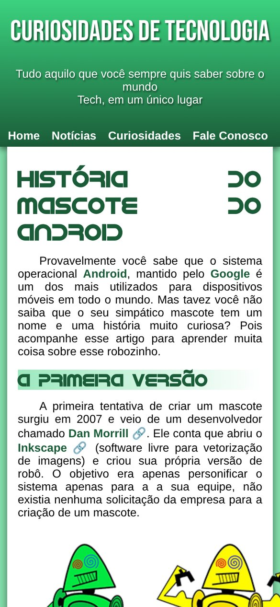

# HTML and CSS Studies

My exercises and challenges from the HTML5 and CSS3 course by [Curso em Vídeo](https://www.cursoemvideo.com/), taught by Gustavo Guanabara: 27 class exercises, 15 challenges and a few extra pages and projects, from a first "Olá, Mundo!" page to Flexbox, Grid and media queries.

**Live pages:** [pedrorosszny.github.io/html-css](https://pedrorosszny.github.io/html-css/), with a list of every exercise and challenge.

The pages are in Brazilian Portuguese, like the course.


## Highlights

| [Challenge 010: tech curiosities](https://pedrorosszny.github.io/html-css/desafios/D010/) | [Challenge 012: Cordel Moderno](https://pedrorosszny.github.io/html-css/desafios/D012/) | [Social media project](https://pedrorosszny.github.io/html-css/outros/projeto-social/) |
|---|---|---|
|  |  |  |

Challenge 010 also adapts to small screens:



## Contents

### Class exercises ([`exercicios`](exercicios))

| Exercises | Topic |
|---|---|
| 001 to 009 | first page, paragraphs, images, favicon, heading levels, text formatting, lists, links |
| 010 and 011 | audio and video with HTML5 |
| 012 to 014 | inline, internal and external CSS |
| 015 to 017 | colors, fonts and Google Fonts |
| 018 and 019 | custom selectors and `:hover` |
| 020 and 021 | box model and background images |
| 022 to 024 | tables, iframes and forms |
| 025 to 027 | media queries, Flexbox and Grid |

### Challenges ([`desafios`](desafios))

| Challenge | Page |
|---|---|
| 001 to 004 | messages, images, a world map and favorite emojis |
| 005 | my social media links |
| 006 to 009 | HTML tags, a flexible image, navigation between pages and a video list |
| 010 | tech curiosities: the history of the Android mascot |
| 011 | full-page background image |
| 012 | Cordel Moderno, a poem page with custom fonts |
| 013 and 014 | tables with merged cells |
| 015 | page layout with CSS Grid |

### Other pages ([`outros`](outros))

Second versions of some challenges and lessons (`desafio-10` adds a responsive page, `desafio-15`, `exercicio-aula26`, `exercicio-aula36`), plus two course projects: `projeto-social`, the social media page above, and `projeto-portfolio`, built on the course's portfolio template.

## Running

The pages are plain HTML and CSS, published with GitHub Pages from the `main` branch. [`index.html`](index.html) at the root lists every page. To run them locally, open any file in a browser, or serve the folder to follow links between pages:

```bash
python3 -m http.server 8080
```

Then open, for example, http://localhost:8080/desafios/D012/.

Exercises 010 and 011 play a GuanaCast episode and a sample video supplied by the course. Those files are not in this repository; get them from the [course repository](https://github.com/gustavoguanabara/html-css) and put them in `exercicios/ex010/midia/` and `exercicios/ex011/midia/`.

## License

My code is released under the [MIT License](LICENSE). The exercise statements, the course media and the course's templates belong to Curso em Vídeo.

## Author

Pedro Ross. [GitHub](https://github.com/PedroRossZny) | [LinkedIn](https://www.linkedin.com/in/pedro-ross)
